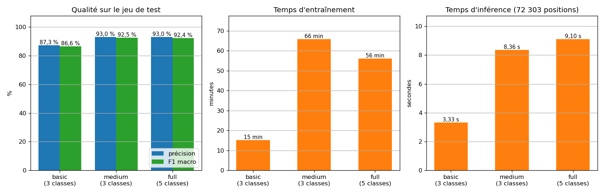
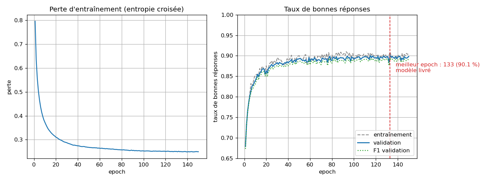
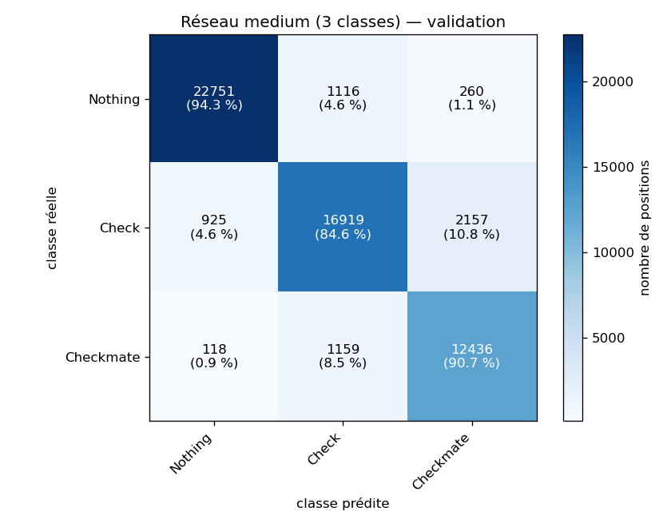

# my_torch

> **EPITECH PROJECT, 2026** · Réseau de neurones en C++17 écrit de zéro, sans
> bibliothèque externe, appliqué à la détection d'échec sur des positions
> d'échecs (FEN).

**Équipe** : Ariel (cœur de réseau) · Divine (données, format `.nn`, analyseur,
métriques, documentation)

---

## 1. Présentation

`my_torch` est une bibliothèque de réseaux de neurones `Dense` écrite en C++17,
avec :

- une classe `Matrix` maison (produit matriciel, opérations terme à terme,
  transposée, sélection de lignes) ;
- des couches `Dense`, `ReLU`, `Sigmoid`, `Tanh`, `Softmax` ;
- une rétropropagation complète, vérifiée par différences finies (écart sous
  `2e-3 + 2 %` du gradient numérique) et par équivalence de poids avec l'oracle
  `StackTrainer` (écart < 1e-4) ;
- un format de réseau binaire `.nn` (magic `MYTN`, version 2) ;
- un générateur de réseau piloté par un fichier de configuration `.conf` ;
- un analyseur en ligne de commande qui entraîne et prédit ;
- des métriques (accuracy, macro-F1, précision/rappel/F1 par classe, matrice de
  confusion) et un export CSV des résultats.

La tâche d'application : **classer une position d'échecs** en `Nothing`,
`Check`, `Checkmate` (mode *basic*, 3 classes) ou en 5 classes avec la couleur du
camp qui donne l'échec (mode *full*) : `Check White` veut dire que les blancs
attaquent le roi noir, qui a le trait.

## 2. Compilation

```bash
make            # libmytorch.a + libchess.a + my_torch_analyzer + my_torch_generator
make tests      # compile et lance les 13 suites de tests
./scripts/check_release.sh   # vérification complète du rendu (33 contrôles)
make debug      # recompile avec ASan + UBSan et lance les tests
make re         # tout recompiler
make clean      # supprime build/ (objets, exécutables de test), garde lib et binaires
make fclean     # supprime tout (build/, lib, binaires)
```

Le produit matriciel est parallélisé avec **OpenMP** et compilé avec
`-march=native` (AVX2/FMA). Pour un binaire portable ou sans OpenMP :
`make OPENMP=0 NATIVE=0`. Après tout changement de ces options, faire `make re`.
Pour l'entraînement, utiliser **4 threads** (4 cœurs physiques, 8 threads
logiques) : `OMP_NUM_THREADS=4` — au-delà, la bande passante mémoire sature et
l'entraînement ralentit.

Prérequis : `g++` compatible C++17 et `make`. `matplotlib` et `numpy` ne sont
nécessaires que pour les graphiques (`scripts/plot_*.py`), pas pour le projet
lui-même.

Aucun warning avec `-Wall -Wextra` : `make` ne produit aucun diagnostic.

## 3. Utilisation

### 3.1 Générer un réseau

```bash
./my_torch_generator configs/basic_network.conf models/basic.nn
# Réseau créé : models/basic.nn (6 couches, 3 classes)

# comme dans l'exemple du sujet : N réseaux numérotés (graines seed, seed+1, ...)
./my_torch_generator configs/basic_network.conf 3
# Réseau créé : basic_network_1.nn ... basic_network_3.nn
```

### 3.2 Entraîner

```bash
# après avoir créé le découpage (voir §6) : split/train.txt et split/test.txt
# réécrit le fichier .nn chargé
./my_torch_analyzer --train models/basic.nn split/train.txt

# écrit un nouveau fichier et laisse l'original intact
./my_torch_analyzer --train --save models/basic_v2.nn models/basic.nn split/train.txt
```

Sortie : une ligne par epoch (`loss`, précision entraînement, précision et F1 de
validation). Trois CSV sont écrits à côté du réseau : `*.curves.csv`,
`*.confusion.csv`, `*.metrics.csv`.

Pour les réseaux **medium** et **full**, chaque position d'entraînement est
transformée par une symétrie de l'échiquier tirée au hasard (miroir
gauche-droite, inversion des couleurs, ou les deux), ce qui multiplie les
orientations vues par quatre. Ces symétries conservent la classe : le miroir, et
l'inversion des couleurs qui retourne **aussi l'échiquier** (un pion blanc attaque
vers le haut, un pion noir vers le bas). Ce retournement a été **ajouté le
27/10/2026** : avant, un échec donné par un pion (4,9 % des échecs) perdait son
étiquette. **Les réseaux `medium` et `full` livrés ont été réentraînés avec la
version corrigée le 5/11/2026** : sur le jeu de test, l'accuracy passe de
86,15 % à 89,97 % (medium) et de 86,04 % à 90,00 % (full), mesures sans
test-time augmentation. Détail, mesures et
vérification dans `docs/DESIGN_CHOICES.md` §18
(`./scripts/audit_augmentation.py`). La validation,
elle, n'est jamais transformée. Le réseau **basic**
(64-32), limité en capacité, est entraîné sans augmentation : mesuré, le
sous-entraînement causé par l'augmentation l'emporte sur le gain de
généralisation. Détails et mesures : `docs/DESIGN_CHOICES.md` §18.

Le fichier `.nn` écrit est celui du **meilleur epoch** au sens de la précision
de validation (et non le dernier epoch) : un réseau qui sur-apprend ne livre
donc pas un modèle dégradé.

### 3.3 Prédire

```bash
./my_torch_analyzer --predict models/basic.nn split/test.txt
```

Une ligne par position, dans l'ordre du fichier : `Nothing`, `Check` ou
`Checkmate` (en mode *full* : `Check White`, `Checkmate Black`, ...).

La prédiction applique une **test-time augmentation** : chaque position est
présentée au réseau dans ses quatre orientations exactes (identité, miroir
gauche-droite, inversion des couleurs, les deux), et les probabilités des quatre
passes sont moyennées avant l'`argmax`. Aucun poids n'est modifié : c'est la même
technique de symétrie qu'à l'entraînement, utilisée ici pour réduire la variance
d'orientation. Gain mesuré sur le jeu de test : **+3,0 à +3,6 points** selon le
réseau (voir §7). Coût : quatre passes avant par position.

### 3.4 Erreurs

Toute erreur est écrite sur **stderr** et le programme se termine avec le code
**84**. `--help` renvoie 0. Un réseau ou un fichier illisible, une FEN mal
formée, un argument manquant ou en trop ne provoquent jamais de crash.

## 4. Architecture du code

| Dossier | Contenu | Responsable |
|---------|---------|-------------|
| `include/mytorch/`, `src/mytorch/` | cœur de réseau : `Matrix`, `Layer`, `Dense`, activations, `Loss`, `Optimizer`, `Trainer`, `Network`, sérialisation `.nn`, métriques, export CSV | Ariel + Divine |
| `include/chess/`, `src/chess/` | module données : FEN, encodage 773 valeurs, étiquettes, dataset | Divine |
| `include/analyzer/`, `src/analyzer/` | analyseur : arguments, mode `--train`, mode `--predict` | Divine |
| `src/generator/` | générateur de réseau à partir d'un `.conf` | Divine |
| `configs/` | configurations `basic` / `medium` / `full` | Divine |
| `scripts/` | découpe du dataset, analyse, évaluation, graphiques | Divine |
| `tests/` | 13 suites de tests unitaires | Ariel + Divine |
| `docs/` | format `.nn`, interfaces, choix de conception, runbook, workflow, plan business | Ariel + Divine |
| `benchmarks/` | résultats chiffrés et graphiques | Divine |
| `bonus/` | documentation du bonus de parallélisme (intégré à `Matrix`) | Ariel |

Le découpage est aussi visible dans le binaire : `make` produit deux archives
distinctes. `libmytorch.a` ne contient **que** le moteur générique (`ar t
libmytorch.a` ne montre aucun objet `Fen`, `Dataset`, `Labels` ou `Augment`) ;
tout ce qui connaît les échecs est dans `libchess.a`. Aucun fichier de
`include/mytorch/` ou `src/mytorch/` n'inclut un en-tête `chess/`, et la
dépendance ne va que dans un sens : `chess` → `mytorch`, jamais l'inverse.

Les documents de référence :

- [`docs/NN_FILE_FORMAT.md`](docs/NN_FILE_FORMAT.md) — format binaire `.nn` et
  format `.conf` ;
- [`docs/INTERFACES.md`](docs/INTERFACES.md) — interfaces entre le cœur de réseau
  et l'analyseur ;
- [`docs/DESIGN_CHOICES.md`](docs/DESIGN_CHOICES.md) — justification de chaque
  choix (encodage, architecture, perte, optimiseur, ...) ;
- [`docs/runbook.md`](docs/runbook.md) — mode d'emploi complet, du clone au rendu ;
- [`docs/TEAM_WORKFLOW.md`](docs/TEAM_WORKFLOW.md) — organisation git de l'équipe ;
- [`docs/business/README.md`](docs/business/README.md) — plan business : marché,
  concurrence, modèle économique, go-to-market et pitch de soutenance.

## 5. Format `.nn` et `.conf`

Un fichier `.nn` est un binaire little-endian natif : magic `MYTN`, version
(2), taille d'entrée, nombre de classes, libellés, hyperparamètres
d'entraînement (epochs, batch, learning rate, momentum, L2, dropout, graine),
puis les couches (type, dimensions, poids, biais).

Un fichier `.conf` est du texte `clé = valeur` :

```
input_size = 773
num_classes = 3
label = Nothing
label = Check
label = Checkmate
hidden_sizes = 256 128 64
hidden_activation = relu
hidden_init = he
output_init = xavier
epochs = 150
batch_size = 128
learning_rate = 0.05
momentum = 0.9
l2 = 0.001
dropout = 0.0
seed = 42
```

## 6. Réentraîner le réseau

```bash
./scripts/make_split.sh dataset/ split/          # 80 / 10 / 10 par classe, graine 42 (3e argument : autre graine)
cat split/train/*.txt > split/train.txt
./my_torch_generator configs/medium_network.conf models/medium.nn
# --train sans --save réécrit le réseau chargé au meilleur epoch de validation
./my_torch_analyzer --train models/medium.nn split/train.txt
./my_torch_analyzer --predict models/medium.nn split/test.txt > predictions.txt
./scripts/evaluate.py predictions.txt split/test.txt
```

### 6.1 Recherche aléatoire d'hyperparamètres

Le module réseau ne dépend d'aucune bibliothèque d'optimisation : la recherche
d'hyperparamètres est un script qui échantillonne des configurations, entraîne
chaque essai sur un sous-échantillon et journalise la meilleure validation.

```bash
./scripts/run_hyperparameter_search.sh --trials 40 --epochs 30 --max-positions 20000
# journal : benchmarks/results/hyperparameter_search.csv
```

Chaque essai écrit un `.conf`, génère un réseau vierge, l'entraîne puis lit
`val_acc` / `val_f1` dans la sortie de l'analyseur. Le tirage est reproductible
(`--seed 42`) et le script refuse une configuration invalide avec le code 84.

## 7. Résultats

Mesurés sur 72 303 positions de test, jamais vues à l'entraînement (dataset
complet : 723 019 positions ; découpage 80 / 10 / 10 par classe). Les prédictions
utilisent la test-time augmentation décrite au §3.3. Les trois réseaux sont
entraînés 150 epochs avec la graine 42 ; `medium` et `full` utilisent
l'augmentation par symétries et `l2 = 1e-3`, `basic` est entraîné sans
augmentation et avec `l2 = 0` (voir §3.2 et `docs/DESIGN_CHOICES.md` §2, §11,
§18).

| Réseau | Classes | Paramètres | Entraînement | Inférence | Précision | F1 macro |
|--------|---------|------------|--------------|-----------|-----------|----------|
| `models/basic.nn` | 3 | 51 715 | 15 min | 3,33 s | 87,26 % | 86,62 % |
| `models/medium.nn` | 3 | 239 491 | 66 min | 8,36 s | **93,05 %** | **92,50 %** |
| `my_torch_network.nn` | 5 | 239 621 | 56 min | 9,10 s | 93,00 % | 92,44 %\* |

\* F1 macro ramené aux 3 classes de base pour comparer les réseaux ; dans son
espace natif de 5 classes, le réseau `full` obtient 91,53 % de F1
macro. Référence : un modèle qui répond toujours `Nothing` plafonne à 41,49 %.

Les temps sont mesurés sur la machine de développement (4 cœurs physiques,
8 threads logiques) avec `OMP_NUM_THREADS=4`. L'inférence est le `--predict` des
72 303 positions de test, chargement du `.nn`, lecture/encodage des FEN et les
quatre passes de la test-time augmentation compris. Ce sont des temps muraux,
sensibles à la charge de la machine.

Le mode *full* distingue en plus la couleur du camp en échec (`Check White`,
`Check Black`, `Checkmate White`, `Checkmate Black`) : dans son espace natif il
obtient 91,53 % de F1 macro, et ses prédictions regroupées en 3 classes
atteignent 92,44 %, pratiquement au niveau du medium (92,50 %).







Détails, métriques par classe et protocole complet :
[`benchmarks/README.md`](benchmarks/README.md). Tous les CSV et graphiques de ce
dossier sont produits à partir de ces trois réseaux, sur le découpage corrigé
(graine 42) ; `scripts/make_tables.py` régénère les tableaux ci-dessus depuis
`benchmarks/results/`.

## 8. Limites connues et pistes d'amélioration

- **L'optimiseur** du cœur de réseau est un SGD avec momentum et L2
  (`Optimizer` + `Trainer`, branchés sur l'analyseur). Adam, RMSProp, Adagrad
  et la décroissance du learning rate ne sont pas implémentés : ils
  demanderaient de faire évoluer le format `.nn`.
- **Le dropout** n'est pas disponible : le champ est lu et stocké dans le `.nn`,
  mais aucune couche `Dropout` n'existe. Le surapprentissage est contenu
  autrement : sélection du meilleur epoch (§12), L2 = 1e-3 sur medium/full (§11)
  et augmentation par les symétries de l'échiquier (§18), qui apporte +4,5 points
  sur le criblage.
- **L'encodage est figé à 773 valeurs** par le plan : c'est un handicap pour une
  détection d'échec, qui est une relation *entre deux cases*. Un encodage
  positionnel (coordonnées, cases relatives) améliorerait nettement la précision.
- **La parallélisation** est faite sur un seul processus (OpenMP sur le produit
  matriciel, bonus du sujet) ; il n'y a pas de distribution multi-machines.
- Les positions du jeu de test ne sont jamais vues à l'entraînement : le
  découpage 80/10/10 par classe est fait avant tout entraînement.

## 9. Contraintes respectées

- Aucune dépendance externe : tout est écrit dans le projet (C++17, `make`,
  scripts Python standard + `matplotlib` pour les graphiques uniquement).
- Aucun binaire de compilation ni dataset versionné : `.gitignore` exclut
  `dataset/`, `libmytorch.a`, `libchess.a` et les deux exécutables.
- Le réseau livré à la racine `my_torch_network.nn` (le **full**, 5 classes)
  **est** versionné : c'est la pièce de rendu évaluée par l'autograder. Les
  deux réseaux de démonstration `models/basic.nn` et `models/medium.nn`, ainsi
  que la copie `models/full.nn`, sont versionnés eux aussi.
- Un seul `my_torch_network*.nn` est présent à la racine : l'autograder prend
  le premier fichier correspondant, il doit donc tomber sur le réseau 5
  classes capable de prédire la couleur (`Check White` / `Check Black`).
- Les scripts d'entraînement et de tracé sont conservés dans `scripts/`.
