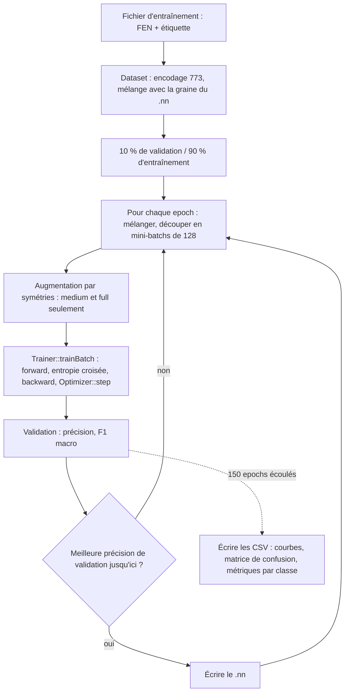
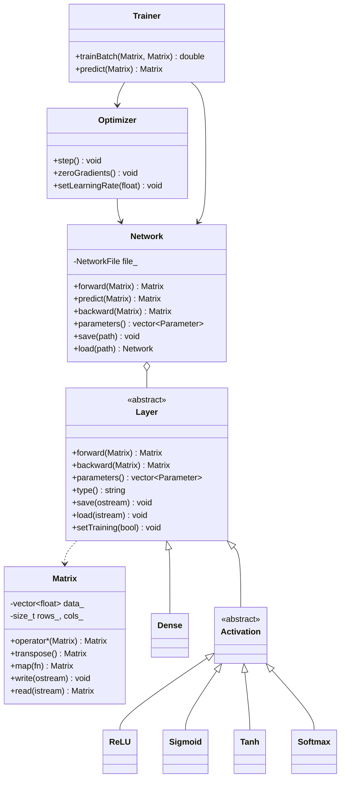
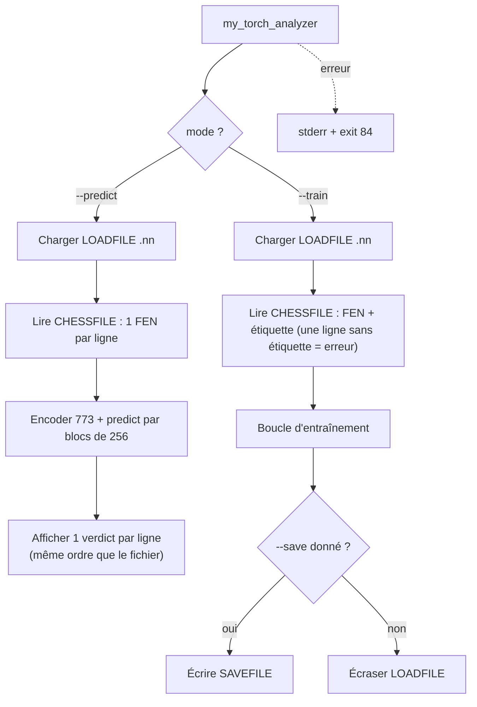
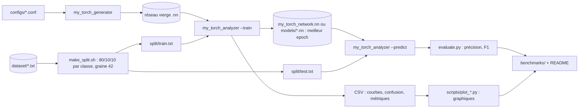

# MY_TORCH — Explication du projet

> Projet Epitech G-CNA-501 · « A Clash of Kings »
> Un réseau de neurones écrit **à la main, en C++17** (sans PyTorch / TensorFlow ni aucune lib de deep learning) qui regarde un échiquier et dit s'il y a **échec**, **échec et mat** ou **rien**.

> **Mis à jour le 06/11/2026.** Ce document décrit le projet **tel qu'il a été livré**.
> Les sections 1 à 4 (idée, FEN, règles, encodage) sont inchangées dans le fond ; les
> sections 5 à 14 ont été réécrites. La conception initiale prévoyait plus de choses
> (Dropout, Adam, recherche d'hyperparamètres en C++, dossier `bonus/` avec son Makefile) :
> la section 12 dit exactement ce qui a été **prévu, fait, remplacé ou abandonné**.
> Les détails et les justifications chiffrées sont dans `docs/DESIGN_CHOICES.md` et
> `benchmarks/README.md`.

---

## 1. L'idée en une phrase

```
   Position d'échecs (FEN)  ──►  [ TON réseau de neurones ]  ──►  Nothing / Check / Checkmate
```

Tu n'écris **pas** un moteur d'échecs qui calcule les règles. Tu **entraînes** un réseau avec des centaines de milliers d'exemples étiquetés (apprentissage supervisé) pour qu'il apprenne à reconnaître ces situations tout seul.

---

## 2. Les trois blocs du projet

```
┌─────────────────────────────────────────────────────────────────────────────┐
│                                 MY_TORCH                                    │
│                                                                             │
│  ┌────────────────────────┐     ┌──────────────────────┐   ┌─────────────┐  │
│  │ libmytorch.a           │◄────│ libchess.a           │◄──│ my_torch_   │  │
│  │ moteur GÉNÉRIQUE       │     │ tout ce qui connaît  │   │ analyzer    │  │
│  │ Matrix, Layer, Dense,  │     │ les échecs :         │   │ --train     │  │
│  │ activations, Loss,     │     │ FEN, Labels, Dataset,│   │ --predict   │  │
│  │ Network, Optimizer,    │     │ Augment              │   └─────────────┘  │
│  │ Trainer, Serializer,   │     └──────────────────────┘   ┌─────────────┐  │
│  │ NetworkConfig, Metrics │◄───────────────────────────────│ my_torch_   │  │
│  └────────────────────────┘                                │ generator   │  │
│                                                            └─────────────┘  │
│  + dataset (non versionné), scripts, 3 réseaux pré-entraînés, benchmarks    │
└─────────────────────────────────────────────────────────────────────────────┘
```

| Bloc | Rôle | Sait-il jouer aux échecs ? |
|---|---|---|
| **`libmytorch.a`** | La « boîte à outils » : couches, activations, rétropropagation, optimiseur, sauvegarde et chargement `.nn`, métriques | **Non**, et c'est vérifié : `ar t libmytorch.a` ne montre aucun objet `Fen`, `Dataset`, `Labels` ou `Augment`, et aucun fichier de `mytorch/` n'inclut `chess/` (contrôlé par `scripts/check_release.sh`) |
| **`libchess.a`** | Traduit une FEN en 773 nombres, lit le dataset, convertit les étiquettes, augmente les données | Oui |
| **`my_torch_analyzer`** | Entraîne (`--train`) ou prédit (`--predict`) en reliant les deux bibliothèques | Oui (il les utilise) |
| **`my_torch_generator`** | Crée un réseau vierge à partir d'un fichier de configuration `.conf` | Non |

---

## 3. Comprendre l'entrée : la notation FEN

Une ligne FEN décrit **toute** une position :

```
rnbqkbnr/pppppppp/8/8/8/8/PPPPPPPP/RNBQKBNR  w  KQkq  -  0  1
└────────────── 1. pièces ───────────────┘   │   │    │  │  └ n° du coup
                                             │   │    │  └ demi-coups depuis dernière prise/pion
                                             │   │    └ case « en passant »
                                             │   └ droits de roque
                                             └ trait : w = blancs, b = noirs
```

### Le champ « pièces » se lit rangée par rangée (de la 8 à la 1)

- Majuscule = blanc, minuscule = noir
- `p`/`P` pion · `r`/`R` tour · `n`/`N` cavalier · `b`/`B` fou · `q`/`Q` dame · `k`/`K` roi
- Un chiffre = ce nombre de cases vides
- `/` = on passe à la rangée suivante
- **Chaque rangée fait toujours 8 cases** (lettre = 1 case, chiffre = sa valeur) : c'est le moyen de vérifier qu'une FEN est valide.
- Dans une rangée, on lit de gauche à droite, colonne **a** à **h**.

### Exemple détaillé

`8/8/R2k4/4r1p1/8/5K2/5P2/8 b - - 7 59`

Les 6 champs : pièces = `8/8/R2k4/4r1p1/8/5K2/5P2/8` · trait = `b` (aux noirs de jouer) · roque = `-` (aucun) · en passant = `-` (aucune) · demi-coups = `7` · coup n° = `59`.

Les 8 morceaux du champ « pièces », de la rangée 8 à la rangée 1 :

| Morceau | Rangée | Lecture |
|---|:---:|---|
| `8` | 8 | 8 cases vides |
| `8` | 7 | 8 cases vides |
| `R2k4` | 6 | tour blanche (a6), 2 vides (b6, c6), roi noir (d6), 4 vides (e6→h6) |
| `4r1p1` | 5 | 4 vides (a5→d5), tour noire (e5), 1 vide (f5), pion noir (g5), 1 vide (h5) |
| `8` | 4 | 8 cases vides |
| `5K2` | 3 | 5 vides (a3→e3), roi blanc (f3), 2 vides (g3, h3) |
| `5P2` | 2 | 5 vides (a2→e2), pion blanc (f2), 2 vides (g2, h2) |
| `8` | 1 | 8 cases vides |

```
     a  b  c  d  e  f  g  h
  8  .  .  .  .  .  .  .  .
  7  .  .  .  .  .  .  .  .
  6  R  .  .  k  .  .  .  .      ← "R2k4" : R, 2 vides, k, 4 vides
  5  .  .  .  .  r  .  p  .      ← "4r1p1"
  4  .  .  .  .  .  .  .  .
  3  .  .  .  .  .  K  .  .      ← "5K2"
  2  .  .  .  .  .  P  .  .      ← "5P2"
  1  .  .  .  .  .  .  .  .
```

Pièces présentes (6) : tour blanche a6, roi noir d6, tour noire e5, pion noir g5, roi blanc f3, pion blanc f2.

**Que se passe-t-il sur l'échiquier ?** C'est aux noirs de jouer, et leur roi (d6) est attaqué par la tour blanche (a6) : b6 et c6 sont vides, rien ne bloque. C'est un **échec**. Le dataset l'étiquette `Check White` : la couleur de l'étiquette désigne le camp qui **attaque** (voir §3 bis, point 7, où ce sens est maintenant vérifié sur tout le dataset). Pour trouver ça, le réseau a besoin de **où sont les pièces** (champ 1) et de **qui doit jouer** (champ 2).

---

## 3 bis. Les règles d'échecs à connaître

Tu n'as **pas** à coder les règles : le réseau doit les apprendre à partir des exemples. Mais il faut les connaître pour comprendre les étiquettes, écrire des tests fiables et justifier tes choix.

### 1. Les déplacements et attaques des pièces

C'est l'essentiel. Une pièce « attaque » les cases où elle pourrait capturer.

| Pièce | Attaque | Particularité |
|---|---|---|
| **Tour** (R) | en ligne droite, horizontale ou verticale, sur toute la distance | bloquée par la première pièce rencontrée |
| **Fou** (B) | en diagonale, sur toute la distance | bloqué par la première pièce rencontrée |
| **Dame** (Q) | comme une tour **plus** un fou | bloquée aussi |
| **Cavalier** (N) | en « L » (2 cases + 1 case) | **saute** par-dessus les autres pièces, rien ne le bloque |
| **Roi** (K) | les 8 cases adjacentes | ne peut jamais aller sur une case attaquée |
| **Pion** (P) | **en diagonale vers l'avant** (1 case) | il avance tout droit mais capture en diagonale |

Pour le pion, la direction dépend de la couleur : les pions blancs montent (vers la rangée 8), les noirs descendent (vers la rangée 1). C'est l'erreur la plus fréquente quand on code une détection d'échec, **et elle a une conséquence pour l'augmentation de données** (voir §6 et `docs/DESIGN_CHOICES.md` §18).

### 2. L'échec (Check)

Un roi est **en échec** quand au moins une pièce adverse l'attaque. Deux conséquences :
- une pièce placée entre l'attaquant et le roi bloque l'attaque des pièces à longue portée (tour, fou, dame), mais pas celle d'un cavalier ou d'un pion ;
- il peut y avoir un **échec double** (deux attaquants à la fois).

Un roi est donc en échec par une pièce à longue portée seulement si la ligne entre elle et lui est **vide**. Dans l'exemple de la section 3, la tour blanche a6 attaque le roi noir d6 parce que b6 et c6 sont vides.

### 3. L'échec et mat (Checkmate)

Le roi est en échec **et** le joueur qui a le trait n'a **aucun coup légal** pour s'en sortir. Il y a trois façons de parer un échec, et il faut qu'aucune ne fonctionne :
1. **déplacer le roi** sur une case non attaquée (il peut capturer l'attaquant seulement si la pièce n'est pas protégée) ;
2. **capturer** la pièce qui donne l'échec ;
3. **interposer** une pièce entre l'attaquant et le roi (impossible contre un cavalier ou un pion, et en cas d'échec double).

### 4. Le trait (qui joue)

C'est le champ `w`/`b` de la FEN. Les positions du dataset sont des positions **légales** : seul le camp qui a le trait peut être en échec ou mat. On ne verra pas un roi blanc en échec pendant que c'est aux noirs de jouer. C'est pourquoi le trait est une entrée du réseau.

### 5. Le pat (bonus)

Le roi n'est **pas** en échec, mais le joueur n'a **aucun coup légal**. C'est une nulle. C'est difficile à repérer parce qu'il faut savoir qu'aucune pièce ne peut bouger légalement. Le dataset n'en contient aucun, et le projet ne le gère pas.

### 6. Ce que tu n'as pas besoin de connaître

- **Les coups spéciaux** (roque, prise en passant, promotion) : ils ne changent presque jamais le verdict d'une position. Les droits de roque sont dans la FEN mais influencent très peu l'étiquette.
- **La stratégie ou la valeur des pièces**, la règle des 50 coups, la répétition de position.
- **Les ouvertures et les finales.**

### 7. Le sens de l'étiquette (vérifié)

La couleur de l'étiquette désigne le camp **qui attaque** : `Checkmate Black` veut dire que les noirs ont maté le roi blanc. C'est **vérifié sur les 723 019 positions** du dataset : `scripts/analyze_dataset.py` constate que la couleur est toujours l'opposé du trait, et un détecteur d'échec indépendant (`scripts/audit_augmentation.py`) trouve que 100,00 % des positions `Check`/`Checkmate` ont bien le roi du camp qui a le trait attaqué, contre 0,00 % des positions `Nothing`.

### Quelle utilité pour le projet

- **Écrire des tests fiables** : tu dois pouvoir construire à la main une position d'échec, de mat ou de rien et prédire ce que doit répondre le réseau.
- **Comprendre ce que le réseau doit apprendre** : repérer des lignes entre pièces, des diagonales, des sauts de cavalier. Un réseau dense apprend cela difficilement, ce qui explique que la précision plafonne autour de 86 % (voir `benchmarks/README.md`, §5).
- **Choix d'entrée** : on aurait pu ajouter des informations calculées à partir des règles (par exemple, quelles cases sont attaquées) au vecteur d'entrée. Ce n'a pas été fait : cela s'éloigne de l'idée « le réseau apprend tout seul ».

---

## 4. Transformer l'échiquier en nombres (encodage)

Un réseau ne comprend que des nombres. On utilise un **encodage « one-hot » par case** :

```
64 cases  ×  12 types de pièces  =  768 valeurs (0 ou 1)
            └ {P,N,B,R,Q,K} × {blanc,noir}

+ 1 valeur pour le trait (1 = blancs)
+ 4 valeurs pour les droits de roque (K, Q, k, q)
─────────────────────────────────────────────
= 773 entrées
```

Illustration pour **une** case :

```
Case e5 contient une tour noire (r) :

 index :   P  N  B  R  Q  K | p  n  b  r  q  k
 valeur :  0  0  0  0  0  0 | 0  0  0  1  0  0     ← un seul « 1 » parmi les 12
```

Le vecteur final de 773 nombres est ce que le réseau reçoit en entrée. Les cases sont numérotées rangée 8 → 1, puis colonne a → h (la case a8 est l'indice 0).

---

## 5. Le réseau de neurones livré

### 5.1 Un neurone

```
   x1 ──w1──┐
   x2 ──w2──┤
   x3 ──w3──┼──► Σ (wi·xi) + b ──► f(…) ──► sortie
   …        │         ▲              ▲
   xn ──wn──┘       biais        activation
                                (ReLU, sigmoid, tanh…)
```

### 5.2 Les trois réseaux

```
 ENTRÉE         COUCHES CACHÉES (Dense + ReLU)                      SORTIE
 (773)                                                       (Dense + Softmax)

  ●  ┐                                                              
  ●  │            ●            ●           ●                        ●  Nothing
  ●  ├────────►   ●  ────────► ●  ───────► ●  ────────────►         ●  Check
  ●  │   256      ●    128      ●     64    ●                        ●  Checkmate
  …  │          (256)        (128)        (64)
  ●  ┘                  exemple : le réseau « medium »
```

| Réseau | Architecture | Sorties | Paramètres | Entraînement |
|---|---|---|---:|---|
| `basic` | 773 → 64 → 32 → 3 | `Nothing`, `Check`, `Checkmate` | 51 715 | 15 min, sans augmentation, L2 = 0 |
| `medium` | 773 → 256 → 128 → 64 → 3 | idem | 239 491 | 66 min, avec augmentation, L2 = 1e-3 |
| `full` | 773 → 256 → 128 → 64 → 5 | `Nothing`, `Check White`, `Check Black`, `Checkmate White`, `Checkmate Black` | 239 621 | 56 min, avec augmentation, L2 = 1e-3 |

- **Softmax** en sortie : transforme les scores en probabilités (somme = 1). On prend la classe la plus probable.
- Initialisation : **He** pour les couches cachées (ReLU), **Xavier** pour la sortie.
- Le sujet parle de trois niveaux de sortie ; le niveau « bonus » (7 classes avec le pat) n'a pas été réalisé : le dataset ne contient aucune position de pat.

---

## 6. Comment le réseau apprend (boucle d'entraînement réelle)



Le nombre d'epochs est **fixe** (150, écrit dans le `.conf` puis dans le `.nn`). Il n'y a pas d'arrêt anticipé avec « patience » : à la place, le `.nn` est réécrit à chaque amélioration de la précision de validation, donc **le fichier livré est celui du meilleur epoch**, pas du dernier.

### Les briques et leur état

| Brique | Rôle | État |
|---|---|---|
| `Matrix` | classe de matrices `float` maison, produit matriciel parallélisé avec **OpenMP** (bonus du sujet) | ✔ |
| `Layer` | interface : `forward`, `backward`, `parameters`, `save`, `load` | ✔ |
| `Dense` | `Z = X·W + b` | ✔ |
| ReLU, Sigmoid, Tanh, Softmax | activations (softmax stable : on soustrait le maximum) | ✔ |
| `crossEntropy` | perte et son gradient `-y / (p·N)` | ✔ |
| `Optimizer` | descente de gradient avec **momentum** et régularisation **L2** | ✔ |
| `Trainer` | un pas d'entraînement sur un mini-batch | ✔ |
| Initialisation | Xavier, He, LeCun | ✔ |
| Mini-batch | taille 128, mélange à chaque epoch | ✔ |
| Régularisation | L2, augmentation par symétries, sélection du meilleur epoch | ✔ (défaut sur les pions corrigé le 27/10, voir ci-dessous) |
| Adam, décroissance du learning rate | — | ✘ le format `.nn` (version 2) ne stocke pas le type d'optimiseur |
| Dropout, MC dropout | — | ✘ non implémentés (le champ `dropout` du `.nn` est inerte ; une valeur ≠ 0 est refusée dans un `.conf`) |
| Arrêt anticipé (patience) | — | ✘ remplacé par le meilleur epoch |
| Rééquilibrage des classes | `Dataset::getClassWeights`, `Dataset::balanceClasses` | outils disponibles, **non utilisés** à l'entraînement ; le F1 macro sert de garde-fou |

**Défaut corrigé de l'augmentation (27/10/2026).** Le miroir gauche-droite conserve toujours la classe. L'inversion des couleurs, elle, ne la conservait pas quand un **pion** donnait l'échec (4,9 % des échecs), parce qu'elle ne retournait pas l'échiquier alors qu'un pion blanc attaque vers le haut et un pion noir vers le bas. Le code retourne maintenant aussi les rangées : vérifié à 100,00 % sur 120 000 positions du dataset. **Les réseaux `medium` et `full` livrés ont été réentraînés avec la version corrigée le 5/11/2026** : sur le jeu de test, en une passe (sans TTA), l'accuracy passe de 86,15 % à 89,97 % (medium) et de 86,04 % à 90,00 % (full). Mesure, correctif et vérification : `docs/DESIGN_CHOICES.md` §18 et `./scripts/audit_augmentation.py`. À la prédiction, une test-time augmentation moyenne les quatre symétries exactes (§19) : le test monte à 93,05 % (medium) et 93,00 % (full).

### Architecture C++ du module



La perte `crossEntropy(probabilités, cibles)` est une fonction libre qui renvoie la valeur et le gradient. `Serializer`, `NetworkConfig`, `Metrics` et `Report` (courbes, matrice de confusion, F1) complètent le module ; `StackTrainer` n'est conservé que comme **oracle de test** (il prouve que `Trainer` reproduit exactement l'ancien moteur de repli).

Points d'attention propres au C++ :
- **Mémoire** : `std::unique_ptr<Layer>` dans le réseau (pas de `new`/`delete` à la main).
- **Erreurs** : le module lève des exceptions (famille `mytorch::Error`) ; le `main` de l'analyseur les attrape, écrit sur `stderr` et renvoie 84.
- **Performance** : `float`, stockage contigu, boucles du produit matriciel ordonnées pour le cache, `-O3`, `-march=native` et OpenMP (`OMP_NUM_THREADS=4` pour l'entraînement).
- **Reproductibilité** : `std::mt19937` initialisé avec la graine du `.nn` (42).

---

## 7. Le dataset fourni

```
dataset/
├── check/       10_pieces.txt  20_pieces.txt  many_pieces.txt
├── checkmate/   10_pieces.txt  20_pieces.txt  many_pieces.txt
└── nothing/     10_pieces.txt  20_pieces.txt  many_pieces.txt
```

Une ligne = une position + son étiquette :
```
1k1r4/p1R3pp/QpK2p2/4n3/8/2r5/Pq4P1/8 w - - 1 30 Checkmate Black
└──────────────── FEN ────────────────┘            └ étiquette ┘
```

| Classe | 10 pièces | 20 pièces | many | **Total** |
|---|---:|---:|---:|---:|
| check | 75 198 | 100 000 | 74 102 | 249 300 |
| checkmate | 45 087 | 100 000 | 28 632 | 173 719 |
| nothing | 100 000 | 100 000 | 100 000 | 300 000 |
| | | | | **723 019** |

```
Répartition des classes (déséquilibrée !)

 nothing   ████████████████████  300 000
 check     ████████████████      249 300
 checkmate ███████████           173 719
```

⚠️ **Piège** : classes déséquilibrées → ne pas regarder que l'accuracy. Un modèle qui répondrait toujours `Nothing` obtiendrait 41,49 % de précision. On suit donc le **F1 macro** et la matrice de confusion.

**Découpage réellement utilisé** (`scripts/make_split.sh`, graine 42, **reproductible**) : 80 % / 10 % / 10 % **par classe**.

| Fichier | Positions | Usage |
|---|---:|---|
| `split/train.txt` | 578 415 | entraînement ; l'analyseur en prélève lui-même 10 % pour la **validation** (57 841), le reste (520 574) sert aux gradients |
| `split/test.txt` | 72 303 | **test**, lu une seule fois à la fin |
| `split/val/` | 72 301 | écrit par le script mais **non utilisé** par la procédure d'entraînement finale |

Aucune ligne n'est commune à l'entraînement et au test (vérifié).

---

## 8. Les exécutables

```
./my_torch_analyzer [--predict | --train [--save SAVEFILE]] LOADFILE CHESSFILE
./my_torch_generator CONFIG_FILE OUTPUT_FILE
./my_torch_generator CONFIG_FILE_1 NB_1 [CONFIG_FILE_2 NB_2 ...]
```



Exemple de sortie (les 5 positions du sujet, `medium`) :
```
$ ./my_torch_analyzer --predict models/medium.nn chessboards.txt
Checkmate
Nothing
Nothing
Check
Nothing
```

Règles respectées (contrôlées par `scripts/check_release.sh`, 33 contrôles) :
- erreurs → **stderr**, puis code **84** (0 si tout va bien ; `--help` renvoie 0) ;
- `--save` refusé avec `--predict` ;
- `Makefile` avec `all`, `re`, `clean`, `fclean` ; `make tests` lance les 13 suites ; `make debug` les relance avec AddressSanitizer et UBSan ;
- `make OPENMP=0 NATIVE=0` donne un binaire portable, sans OpenMP.

---

## 9. Le pipeline complet, de bout en bout



Résultats sur le jeu de test (72 303 positions, avec test-time augmentation,
voir `benchmarks/README.md`) :

| Réseau | Précision | F1 macro |
|---|---:|---:|
| `basic` | 87,26 % | 86,62 % |
| `medium` | **93,05 %** | **92,50 %** |
| `full` | 93,00 % | 92,44 % (91,53 % dans son espace natif de 5 classes) |

---

## 10. Les formats de fichiers

La spécification complète est dans **`docs/NN_FILE_FORMAT.md`**. En résumé, un fichier `.nn` est un **binaire versionné** (ordre des octets natif, little-endian sur x86-64) :

```
┌────────────────────────────────────────────────────────────────┐
│ EN-TÊTE      magic « MYTN » · version 2 · nb de couches        │
│              taille d'entrée (773) · nb de classes · libellés  │
├────────────────────────────────────────────────────────────────┤
│ HYPERPARAMÈTRES  epochs · batch · learning rate · momentum ·   │
│                  L2 · dropout (inerte) · graine                │
├────────────────────────────────────────────────────────────────┤
│ POUR CHAQUE COUCHE   type (dense, relu, sigmoid, tanh, softmax)│
│                      + paramètres (Dense : poids W puis biais b)│
└────────────────────────────────────────────────────────────────┘
```

Le fichier est **auto-suffisant** : l'analyseur n'a besoin d'aucune option pour les hyperparamètres, ils sont lus dans le `.nn`. Un fichier au mauvais magic, de mauvaise version ou tronqué est refusé avec le code 84.

Un fichier `.conf` est du texte `clé = valeur` (exemple : `configs/medium_network.conf`) :

```
input_size = 773
num_classes = 3
label = Nothing
label = Check
label = Checkmate
hidden_sizes = 256 128 64
hidden_activation = relu
hidden_init = he
output_init = xavier
epochs = 150
batch_size = 128
learning_rate = 0.05
momentum = 0.9
l2 = 0.001
dropout = 0.0
seed = 42
```

Le générateur accepte **les deux syntaxes** :
```
$ ./my_torch_generator configs/medium_network.conf models/medium.nn
$ ./my_torch_generator configs/basic_network.conf 3
→ basic_network_1.nn  basic_network_2.nn  basic_network_3.nn
```

---

## 11. Ce qui est noté / attendu, et où on en est

| Priorité | Élément | État |
|---|---|---|
| **MUST** | Module NN : créer, sauvegarder/charger, entraîner | ✔ |
| **MUST** | Analyseur `--train` / `--predict`, entrée FEN | ✔ |
| **MUST** | Apprentissage supervisé, aucune lib de deep learning | ✔ (contrôlé par `check_release.sh`) |
| **MUST** | Réseau pré-entraîné nommé `my_torch_network*` | ✔ (`my_torch_network.nn` à la racine : full 5 classes ; `models/` garde basic, medium et une copie du full) |
| **MUST** | Lutter contre l'overfitting | ✔ L2 + augmentation + meilleur epoch ; sur `medium`, écart train/validation sous 1 point en fin d'entraînement |
| **MUST** | Optimiser les hyperparamètres | ✔ random search de **40 essais** (30 epochs, 20 000 positions, journal versionné) en appui des expériences ciblées (momentum, taille du réseau, L2, augmentation) (voir §12) |
| **MUST** | README + justification de **tous** les choix | ✔ `README.md`, `docs/DESIGN_CHOICES.md` |
| **MUST** | Garder scripts + datasets (à montrer en soutenance) | ✔ scripts versionnés ; dataset non versionné, présenté à la soutenance |
| SHOULD | Benchmarks **avec preuves visuelles** | ✔ `benchmarks/plots/`, CSV, `evaluate.py` |
| Bonus | Calcul parallèle | ✔ OpenMP sur le produit matriciel |
| Bonus | Plusieurs métriques (précision, rappel, F1, confusion) | ✔ |
| Bonus | Pat, IA qui joue, comparaison de courbes sur un même graphique | ✘ |

Objectif visé en cours de projet : **plus de 90 % de précision en validation**. Il est **atteint** : le `medium` obtient 90,08 % en validation à son meilleur epoch et 93,05 % sur le jeu de test ; le `full` atteint 90,11 % en validation et 93,00 % sur le test. Les chiffres de test incluent la test-time augmentation ; la validation, utilisée pour choisir le meilleur epoch, est mesurée en une passe.

---

## 12. Prévu, fait, remplacé, abandonné

Le plan initial (`docs/plan_repartition_mytorch.pdf`, 21 jours du 14/10 au 03/11/2026) et ce qui s'est réellement passé :

| Prévu | Réalisé |
|---|---|
| Cœur du réseau : `Matrix`, `Dense`, activations, perte, backprop, XOR, gradient numérique | ✔ fait (`tests/test_layers.cpp`, `tests/test_network.cpp`) |
| Parseur FEN, `Dataset`, étiquettes, CLI avec code 84 | ✔ fait |
| Format `.nn` binaire, générateur, `.conf` | ✔ fait ; le générateur accepte aussi la syntaxe `config nombre` du sujet |
| Métriques, export CSV, courbes, graphiques | ✔ fait |
| Optimiseurs : SGD, mini-batch, momentum, **Adam** | SGD + mini-batch + momentum ✔ ; **Adam abandonné** (le `.nn` v2 ne stocke pas le type d'optimiseur) |
| Décroissance du learning rate, **arrêt anticipé**, **dropout**, MC dropout | **abandonnés** ; remplacés par L2 + augmentation + meilleur epoch |
| `HyperSearch` en C++ (random search, algorithme génétique) | **remplacé** par `scripts/hyperparameter_search.py` (random search de **40 essais de 30 epochs** sur 20 000 positions, validation 56,9 % à 65,6 %, meilleur essai n°20 : 65,6 %) : **lr 0,05** et **hidden 256-128-64** en tête en moyenne, ce qui confirme les réglages retenus ; les écarts du peloton de tête restent dans le bruit du sous-échantillon ; pas d'algorithme génétique |
| Sortie avec couleur (`full`) | ✔ fait |
| > 90 % de précision en validation | ✔ 90,08 % (medium) et 90,11 % (full) en validation ; 93,05 % et 93,00 % sur le test avec TTA |
| Bonus : parallélisme | ✔ OpenMP + `-march=native`, intégré à `Matrix` |
| Bonus : pat, MC dropout, dossier `bonus/` avec son Makefile | ✘ abandonnés ; `bonus/` ne contient plus qu'un README |
| Rééquilibrage des classes | outils écrits, non utilisés |

Ajouts non prévus : augmentation par symétries (`Augment`), test-time augmentation à la prédiction (`PredictMode`, §19 de `DESIGN_CHOICES`), séparation `libmytorch.a` / `libchess.a`, `scripts/check_release.sh` (33 contrôles), `scripts/audit_augmentation.py`, `scripts/make_tables.py`.

---

## 13. Structure du dépôt

```
.
├── Makefile                  # all, lib, tests, debug, re, clean, fclean ; OPENMP=0 / NATIVE=0
├── README.md
├── my_torch_network.nn       # réseau livré à la racine : full, 5 classes
├── models/                   # basic.nn, medium.nn (démo) et full.nn (copie)
├── include/
│   ├── mytorch/              # moteur : Matrix, Layer, Dense, Activation, Loss, Network, Optimizer,
│   │                         #   Trainer, Init, Serializer, NetworkConfig, TrainSettings, Metrics,
│   │                         #   Report, StackTrainer (oracle de test), StringUtils, Errors
│   ├── chess/                # Fen, Labels, Dataset, Augment, Errors
│   └── analyzer/             # Cli, TrainMode, PredictMode
├── src/
│   ├── mytorch/              # → libmytorch.a
│   ├── chess/                # → libchess.a
│   ├── analyzer/             # → my_torch_analyzer
│   └── generator/main.cpp    # → my_torch_generator
├── tests/                    # 13 suites : matrix, init, layers, network, serialization, config,
│                             #   metrics, report, fen, dataset, augment, cli, stack_trainer
├── configs/                  # basic / medium / full .conf
├── scripts/                  # make_split.sh, train_*.sh, evaluate.py, analyze_dataset.py,
│                             #   hyperparameter_search.py, audit_augmentation.py, plot_*.py,
│                             #   make_tables.py, check_release.sh
├── benchmarks/               # README + results/ (CSV) + plots/ (PNG)
├── bonus/                    # README (le parallélisme est dans Matrix)
└── docs/                     # DESIGN_CHOICES, NN_FILE_FORMAT, INTERFACES, runbook, TEAM_WORKFLOW,
                              #   EXPLICATION_PROJET (ce fichier), MATHS_ET_IMPLEMENTATION,
                              #   plan_repartition_mytorch.pdf, my_torch-project.pdf (sujet), business/
```

---

## 14. Check-list de rendu (état au 06/11/2026)

Vérifié par `./scripts/check_release.sh` (33 contrôles OK, 0 échec) et par relecture :

- [x] `make` produit `libmytorch.a`, `libchess.a`, `my_torch_analyzer`, `my_torch_generator` sans warning ; `re`/`clean`/`fclean` OK
- [x] 13 suites de tests vertes (`make tests`)
- [x] Parseur FEN fiable : les 723 019 positions du dataset sont lues sans erreur
- [x] Forward + backward vérifiés par gradient numérique (3 activations) et par équivalence avec l'oracle `StackTrainer`
- [x] Format `.nn` : sauvegarde puis chargement donnent les mêmes prédictions
- [x] CLI `--train` / `--predict` / `--save` conformes à `--help`, erreurs sur stderr, code 84
- [x] Découpage reproductible (graine 42), aucune fuite entre entraînement et test
- [x] F1 par classe + matrice de confusion
- [x] `my_torch_network.nn` poussé à la racine (full 5 classes) et
      `models/{basic,medium,full}.nn` versionnés, scripts d'entraînement conservés
- [x] README avec benchmarks visuels et justification des choix
- [x] Sanitizers (`make debug`, AddressSanitizer + UBSan) : 13 suites vertes, aucune anomalie
- [x] Recherche d'hyperparamètres : 40 essais random search (30 epochs, 20 000 positions, validation 56,9 % à 65,6 %, journal `benchmarks/results/hyperparameter_search.csv`)
- [x] Augmentation : code corrigé le 27/10/2026 (l'inversion des couleurs retourne l'échiquier), testé, 100,00 % de classes conservées sur 120 000 positions
- [x] Réseaux `medium` et `full` : réentraînés le 5/11/2026 avec l'augmentation corrigée (même graine, même split)
- [x] Objectif de 90 % de précision : atteint (90,08 % en validation pour `medium`, 93,00 % sur le test pour `full` avec TTA)
