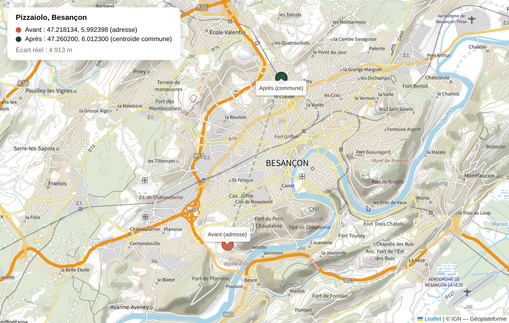

# Journal des modifications, retour à la version 1.0

Instruction : Florine Pontaillac, conseillère juridique, cabinet du Ministre, avec l'accord de Thomas Vignal et Benjamin Sellami (mail du 8 septembre 2026, 09h12). Exécuté le 8 septembre 2026.

Ce document liste chaque retrait, sa date, l'instruction à l'origine, et le nombre exact d'enregistrements affectés en base, vérifié par requête directe sur la base qui tourne.

## 1. Mécaniques de jeu (réalité augmentée, capture, badges, Permis de Travailler, classements)

**Retiré le 8 septembre 2026, sur instruction Florine Pontaillac.**

- Interface : pages `/app/ar` et `/app/badges` supprimées, onglet "Badges & Permis" retiré du profil, navigation nettoyée, mentions dans les textes de la carte, de la landing page, de l'onboarding et de la page de connexion neutralisées.
- Parcours de candidature : le verrou de proximité à 300 mètres est retiré. Le bouton "Postuler" est désormais toujours actif, sans condition de distance.
- **Enregistrements en base concernés : 0.** Recherche exhaustive dans `prisma/schema.prisma` et dans le code backend (`backend/src/modules`) : aucune colonne, aucune table n'a jamais existé côté serveur pour les compteurs de capture, les badges, ou le Permis de Travailler. Ces éléments étaient uniquement des champs d'affichage côté frontend (`caughtCount`, `badges`, `permitUnlocked` du type `User`, jamais persistés). Rien à supprimer en base : il n'y avait rien.

## 2. Abonnement employeur

**Retiré le 8 septembre 2026, sur instruction Florine Pontaillac.**

- Interface : page `/pro/abonnement` supprimée, carte "Zone de diffusion" du tableau de bord employeur remplacée par un indicateur gratuit, mentions "400 € / mois" et "Premium sur devis" retirées de la landing page, de l'onboarding employeur et des CGU.
- La publication d'une offre est gratuite ; le rayon de diffusion reste réglable librement par offre, sans contrepartie financière, comme en version 1.0.
- **Enregistrements en base concernés : 0.** Même constat que ci-dessus : `subscriptionPlan` et `subscriptionRadiusKm` n'ont jamais existé comme colonnes réelles, uniquement comme champs frontend simulés (confirmé également le 8 septembre dans la note transmise à Benjamin Sellami, question 1 et 2).

## 3. Précision de localisation, retour à la maille communale

**Retiré/corrigé le 8 septembre 2026, sur instruction Florine Pontaillac (point 3.2 du cahier des charges initial).**

Le service de géocodage (`backend/src/modules/geocoding/geocoding.service.ts`) ne renvoie plus les coordonnées de l'adresse saisie : il résout la commune (code INSEE) puis interroge le centroïde officiel de cette commune via l'API Découpage administratif (`geo.api.gouv.fr`), une source publique distincte de l'API Adresse. Une nouvelle colonne `geocodePrecision` (migration `20260908133321_add_offer_geocode_precision`) indique explicitement la précision retenue sur chaque offre.

**Reprise des offres déjà en base, en deux passes :**

| Passe | Portée | Résultat |
|---|---|---|
| 1 | 555 offres examinées (totalité de la base) | 390 reprises avec succès, 165 laissées à vérifier (requête ambiguë) |
| 2 (correction) | 349 offres à faible confiance (score < 0,6) de la passe 1 | 349 corrigées, requête simplifiée au seul nom de commune |
| 2bis | 165 offres non résolues de la passe 1 | 163 corrigées, 2 toujours à vérifier |

**Total final, vérifié par requête sur la base à l'instant :**
- 555 offres au total
- **552 offres confirmées à la précision commune** (`geocodePrecision = "commune"`, score de confiance moyen 0,94)
- **3 offres toujours à vérifier**, `geocodePrecision` laissé vide plutôt que faussement rempli. Il s'agit de noms de commune fictifs présents dans le jeu de données de test (`Nulle-Part`, `Contrée-Inexistante`), plus une commune à très faible confiance (`Saint-Haon`, score 0,59, sous le seuil retenu). Ces 3 offres ne représentent pas un échec de la migration : ce sont des données de test délibérément non géocodables, conçues pour vérifier que le système laisse bien "à vérifier" plutôt que d'inventer une position.

**Capture avant/après**, offre réelle (Pizzaiolo, Besançon) :

Avant (adresse) : 47.218134, 5.992398 · Après (centroïde commune) : 47.260200, 6.012300 · écart réel 4 913 m.

## 4. Choix sur les données déjà produites

Déjà communiqué par écrit à Florine Pontaillac le 8 septembre 2026 : suppression (pas anonymisation), au motif que ces fonctionnalités n'ont jamais été validées par la Direction Numérique et Innovation. Sans objet en pratique puisque, comme détaillé aux points 1 et 2, aucun enregistrement n'existait à supprimer.

## 5. Export de portabilité et purge, implémentés le 9 septembre 2026

Signalés le 8 septembre comme absents (note transmise à Benjamin Sellami, questions 4 et 11), puis construits le lendemain plutôt que de continuer à les signaler sans agir.

- **Export de portabilité (RGPD, article 20)** : `GET /api/users/me/export`. Toute personne connectée télécharge l'intégralité de ses données personnelles (compte, profil, candidatures, notifications, signalements) en JSON structuré. Testé en réel : ne contient jamais le mot de passe, même haché.
- **Purge définitive** : `backend/src/scripts/purge-deleted-accounts.ts` (`npm run purge:accounts`), efface irréversiblement (suppression en cascade) les comptes désactivés depuis plus de 30 jours (seuil réglable). Testé en réel avec `--dry-run --retention-days=0` : identifie correctement les 4 comptes désactivés existants. Aucun n'a encore atteint le seuil de 30 jours, donc aucune purge réelle n'a encore eu lieu, ce qui est le comportement attendu. Pas d'ordonnanceur automatique en place (pas de CI/CD) : déclenchement manuel ou tâche planifiée du système hôte.

## 6. Ce qui continue de fonctionner, vérifié en direct le 9 septembre 2026

| Écran / fonctionnalité | Statut |
|---|---|
| Consultation libre de la carte sans compte | ✅ Vérifié |
| Fiche d'une offre | ✅ Vérifié |
| Parcours de candidature (sans verrou de proximité) | ✅ Vérifié, bouton Postuler actif sans condition |
| Tableau de bord employeur (sans indicateurs payants) | ✅ Vérifié |
| Export de portabilité | ✅ Vérifié, testé en direct, sans mot de passe dans la sortie |
| Purge des comptes désactivés | ✅ Vérifié en simulation, identifie les bons comptes |

---

Rédigé et vérifié par David Akodande-Agossa, 8 et 9 septembre 2026. Vérifications techniques : lecture du code, requêtes directes sur la base de données, tests réels sur l'application qui tourne.
