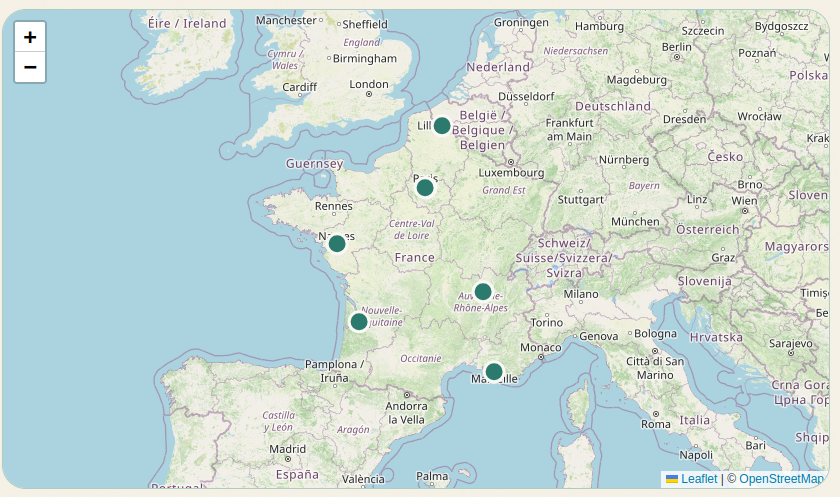
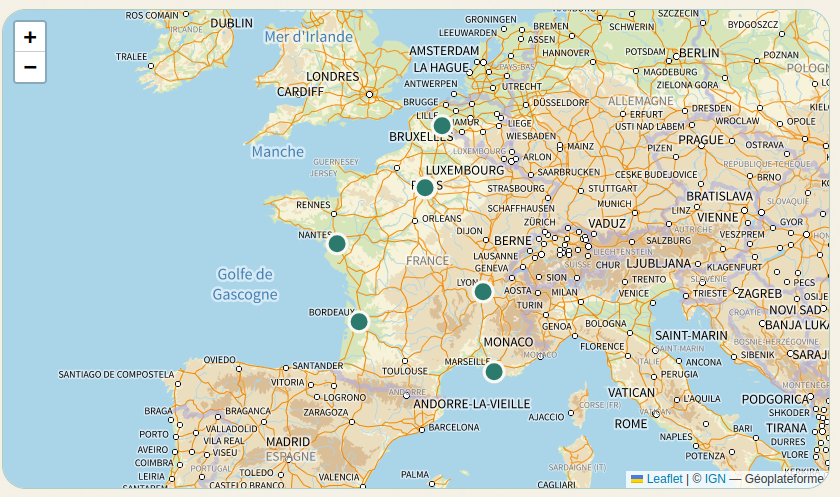

# Note de migration cartographique : OpenStreetMap vers la Géoplateforme IGN

*GéoEmploi, 03/09/2026. Suite au message de M. Vignal du 02/09/2026.*

> Répartition : §1 module 2 (carte) · §2 module 3 (offres) · §3 commun.

---

## 1. Le passage d'un fournisseur à l'autre

### Ce qui a changé

Deux services distincts ont été remplacés, pour deux besoins distincts :

| | Avant | Après |
|---|---|---|
| **Fonds de carte** | OpenStreetMap | Géoplateforme IGN, flux WMTS |
| **Géocodage** | géocodeur précédent | API Adresse (`api-adresse.data.gouv.fr`) |

### Comment cela a été implémenté

**Les tuiles.** Le client cartographique reste **Leaflet** : c'est uniquement la
source des tuiles qui change, pas la bibliothèque de rendu. Nous consommons la
couche `GEOGRAPHICALGRIDSYSTEMS.PLANIGNV2` de la Géoplateforme en projection Web
Mercator (`TILEMATRIXSET=PM`), avec l'attribution IGN affichée sur la carte. Le
changement tient en une déclaration de couche, dans
`frontend/src/components/OffersMap.tsx`. Le flux a été vérifié : la requête de tuile
répond en HTTP 200 et renvoie bien une image PNG.

Le cache serveur des tuiles demandé le 01/09 est indépendant du fournisseur : il
reste placé devant le flux et n'a pas été remis en cause par ce changement.

**Le géocodage.** L'API Adresse devient la seule source de conversion d'une adresse
en coordonnées. Un nouvel appel a été ajouté côté serveur, qui renvoie pour chaque
adresse ses coordonnées, un **score de confiance** et un **libellé normalisé**, trois
informations désormais conservées avec l'offre. Les deux services étant ouverts,
aucune clé n'est nécessaire et aucun secret n'a été ajouté à la configuration.

**Les coordonnées.** Elles restent stockées en WGS84. La projection en **Lambert-93
(EPSG:2154)** exigée pour l'administration et les exports est calculée côté serveur à
la lecture, sans duplication en base. La conversion a été contrôlée sur le point
d'origine de la projection, où (46,5 N ; 3,0 E) rend exactement 700 000 / 6 600 000,
puis sur Paris, Marseille et Brest, aux quelques mètres près des valeurs publiées.

**Traçabilité ajoutée à chaque offre :** source du géocodage, score de confiance,
date d'obtention, statut de vérification, libellé normalisé et, le cas échéant, motif
d'échec. Les offres antérieures à la convention sont marquées comme telles et restent
identifiables sans ambiguïté tant qu'elles n'ont pas été reprises.

### La même vue de carte, avant et après

| Avant : OpenStreetMap | Après : Géoplateforme IGN |
|---|---|
|  |  |

Même vue, même niveau de zoom, mêmes sept offres aux mêmes positions. Seuls changent
le fond de carte et l'attribution, visible en bas à droite : « © OpenStreetMap »
devient celle de l'IGN et de la Géoplateforme.

---

## 2. Le relevé d'écarts

> **Cadre.** La reprise a été exécutée sur le **jeu de démonstration** peuplé par le
> module 3 (`prisma/seed.ts`), en l'absence de données réelles à ce stade. Ce jeu
> contient volontairement des cas limites : offres aux coordonnées « d'avant »
> erronées, adresses insolubles. Les chiffres ci-dessous valident la procédure ; ils
> ne constituent pas un audit de production.

La reprise regéocode l'adresse de chaque offre via l'API Adresse et compare la
nouvelle position à la position stockée. Sur les 15 offres du jeu de démonstration :

| Indicateur | Valeur |
|---|---|
| Offres traitées | 15 |
| Reprises avec succès | 12 |
| En échec, passées en « à vérifier » | 3 |
| Déplacement moyen | 25 701 m |
| Déplacement médian | 147 m |
| Durée totale | 3,2 s |

La moyenne (25,7 km) est **tirée par un unique cas**, le n°1 ci-dessous. La
**médiane, 147 m**, reflète beaucoup mieux la réalité : la grande majorité des offres
ne bougent que de quelques dizaines à quelques centaines de mètres, ce qui correspond
à un simple recalage entre l'ancien géocodeur et l'API Adresse.

### Les cinq déplacements les plus importants, relus un par un

| # | Déplacement | Adresse | Ancienne vers nouvelle position | Score |
|---|---|---|---|---|
| 1 | 281 277 m | Place Stanislas, 54000 Nancy | 48.8566, 2.3522 vers 48.6937, 6.1831 | 0.97 |
| 2 | 11 432 m | Rue Nationale, 37000 Tours | 47.3000, 0.7500 vers 47.3937, 0.6875 | 0.98 |
| 3 | 8 159 m | Quai du Port, 13002 Marseille | 43.3500, 5.3000 vers 43.2960, 5.3683 | 0.97 |
| 4 | 4 961 m | Cours Mirabeau, 13100 Aix-en-Provence | 43.5000, 5.4000 vers 43.5268, 5.4492 | 0.98 |
| 5 | 2 108 m | Grand Place, 59000 Lille | 50.6366, 3.0635 vers 50.6184, 3.0720 | 0.52 |

**Le n°1 (Nancy, 281 km).** À première vue le drapeau rouge annoncé par M. Vignal : un
saut de plusieurs centaines de kilomètres. Après vérification, ce n'en est pas un au
sens d'une anomalie. L'adresse se résout parfaitement à Nancy (score 0.97) ; c'est
l'**ancienne coordonnée qui était fausse**, l'offre étant stockée aux coordonnées de
Paris. La reprise ne casse rien : elle **corrige** une donnée « d'avant » erronée.
C'est exactement le cas que la procédure doit rattraper.

**Le n°5 (Lille, score 0.52).** Déplacement modeste, mais l'adresse n'a été résolue
qu'avec une confiance faible. Elle passe notre seuil de 0,4 de justesse. C'est le cas
à surveiller : une résolution à demi-certaine devrait sans doute basculer en « à
vérifier » plutôt que d'être acceptée telle quelle.

### Les trois échecs

Trois adresses n'ont pas pu être géocodées et sont passées en « à vérifier ». La
reprise ne les a pas déplacées :

| Adresse | Traitement |
|---|---|
| 42 rue du Fantôme Imaginaire, 00000 Nulle-Part | non résolue, « à vérifier » |
| Lieu-dit Les Limbes, 99999 Contrée-Inexistante | non résolue, « à vérifier » |
| Chemin sans nom, Zone Blanche | non résolue, « à vérifier » |

### Sortie brute de la commande

```
$ npm run geocoding:migrate
[reprise] 15 offres à traiter
[reprise] ok: 12  |  à vérifier: 3
[reprise] déplacement moyen : 25 701 m   (médiane 147 m)
[reprise] échecs :
   x 42 rue du Fantôme Imaginaire, 00000 Nulle-Part
   x Lieu-dit Les Limbes, 99999 Contrée-Inexistante
   x Chemin sans nom, Zone Blanche
[reprise] durée totale : 3.2 s
```

---

## 3. Points de vigilance

**Dépendance à un service ouvert.** L'API Adresse ne fait l'objet d'aucun engagement
de disponibilité. Notre reprise le tolère : les appels sortants sont espacés
volontairement, les réponses 429 et 5xx sont réessayées avec un délai croissant, et si
l'API reste indisponible l'offre n'est pas modifiée du tout : elle reste à reprendre
et la prochaine exécution la retentera. Une panne de l'API ne dégrade jamais la base.

**La procédure est rejouable.** Elle ne sélectionne que les offres dont le géocodage
n'est pas encore vérifié, et écrit chaque offre dès qu'elle est traitée plutôt qu'en
fin de parcours. Une exécution interrompue se relance sans précaution : les offres
déjà reprises sortent d'elles-mêmes du périmètre.

**Comportement en cas d'échec.** Une adresse que l'API ne sait pas résoudre, ou qu'elle
résout avec un score trop faible, place l'offre en « localisation à vérifier » avec un
motif explicite, et lui **conserve ses coordonnées actuelles**. Elle reste consultable
là où elle était : elle n'est ni supprimée, ni déplacée par défaut, ni renvoyée en
(0, 0). L'interface de correction manuelle relève du module 4 et fait l'objet d'une
coordination en cours.

**Le formulaire de publication est désormais conforme.** Le point signalé au module 3,
qui acceptait encore des coordonnées transmises par l'employeur, est résolu :
`POST /offers` et `PATCH` ne prennent plus de latitude/longitude du client, ils
reçoivent une adresse et dérivent les coordonnées côté serveur via l'API Adresse,
comme la reprise. Les nouvelles offres naissent donc conformes.

**Précision à la rue.** Le Ministre demande une précision à la rue ; Mme Pontaillac a
émis une réserve au titre de la minimisation des données. Le score renvoyé par l'API
permet de savoir si une adresse a été résolue au numéro ou seulement à la commune :
nous conservons cette information sans trancher l'arbitrage, qui ne nous appartient
pas.

**Un score faible est un signal, pas un détail.** Le cas de Lille (0,52) montre qu'une
adresse peut être « résolue » sans être fiable. Nous recommandons d'ajouter un palier :
en dessous d'un score à définir (0,5 à 0,6), l'offre passe en « à vérifier » même si le
géocodage a répondu. L'information est déjà conservée, il reste à l'exploiter.

**Suivre la médiane, pas la moyenne.** Un seul cas hérité suffit à faire exploser le
déplacement moyen. Pour piloter la reprise sur la vraie base, la médiane et le nombre
de gros écarts sont plus parlants.

**Deux points à corriger avant la mise en données réelles.** D'une part, les trois
adresses insolubles du jeu de démonstration sont stockées aux coordonnées (0, 0) :
la reprise ne les y a pas mises et ne les déplace pas, mais une offre à (0, 0)
s'affiche en plein océan, ce que nous voulons précisément éviter. Une offre non
localisable doit recevoir une position de repli lisible, à défaut d'être masquée de la
carte. D'autre part, deux clients de l'API Adresse coexistent aujourd'hui dans le code,
l'un côté reprise, l'autre côté publication : ils doivent être unifiés pour que le
seuil de confiance soit unique et ne puisse pas diverger.

**À surveiller ensuite.** Le taux d'offres en « à vérifier » : élevé, il traduira une
saisie d'adresse trop libre plus qu'un défaut de l'API. Restent à contrôler sur données
réelles la consultation libre sans compte, la fiche d'offre, la candidature et les
exports.
