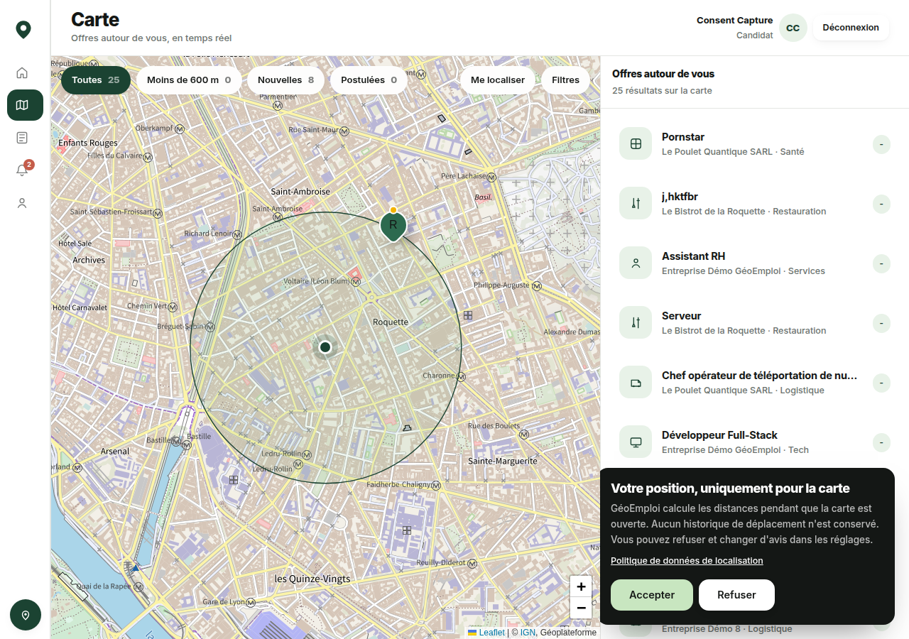
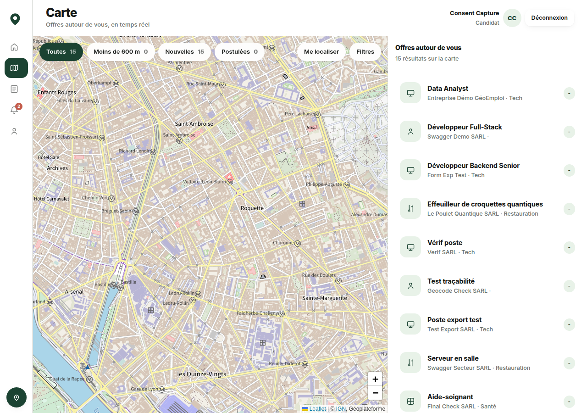
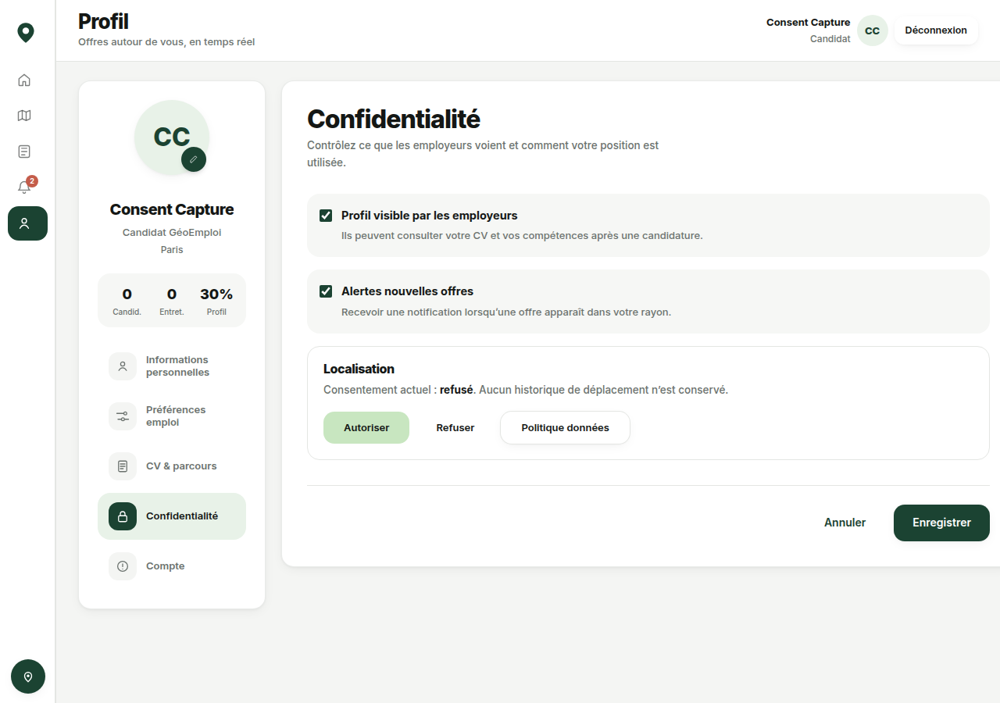
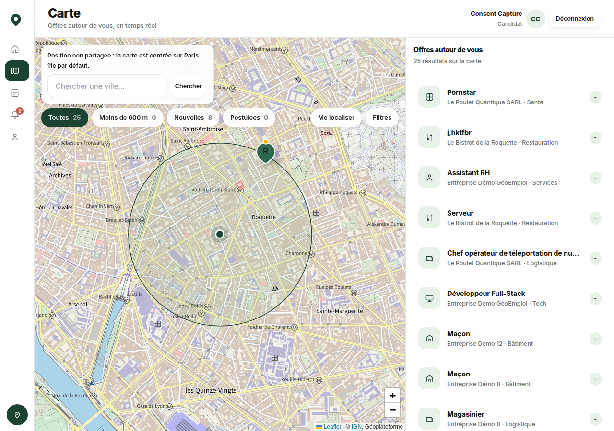

# Tableau de comportements, Consentement géolocalisation (RGPD)

**Responsable** : Module Auth (`feature/auth`), gestion du consentement géoloc + ergonomie du toggle.

**Objet** : détailler, **écran par écran**, le comportement de l'application selon que l'utilisateur a **accepté** ou **refusé** la géolocalisation. Documente les deux parcours (position acceptée / position refusée).

---

## 1. Principe RGPD retenu

Le consentement à la géolocalisation est :
- **explicite** (case/toggle dédié, non pré-coché),
- **libre** (ne bloque pas l'usage du compte),
- **informé** (on explique pourquoi et comment le retirer),
- **révocable à tout moment**, **sans perte** du compte, du profil ou des candidatures,
- **traçable** : `User.geoConsent` + `User.geoConsentUpdatedAt` (date du dernier changement).

| Élément | Valeur |
|---|---|
| Champ BDD | `User.geoConsent` (booléen) + `User.geoConsentUpdatedAt` (horodatage) |
| Endpoint | `PUT /api/users/me/geo-consent` `{ "geoConsent": true/false }` |
| Retrait | Toggle dans le profil → `false` → données de localisation non traitées |
| Impact sur le compte | **Aucun** : compte, profil et candidatures sont conservés |

---

## 2. Parcours A, Position **ACCEPTÉE**

| Écran / étape | Comportement observable |
|---|---|
| **Inscription / Profil** | Case de consentement géoloc cochée (explicite). |
| **Toggle Profil** | Interrupteur "Localisation" = **ON**, date mise à jour (`geoConsentUpdatedAt`). |
| **Recherche d'offres** | l'app obtient la position de l'utilisateur et affiche les offres **à proximité** (tri/radius). |
| **Dashboard** | les offres proposées sont géolocalisées par rapport à la position acceptée. |
| **Enregistrement** | les données de localisation (lat/lng) peuvent être stockées sur `JobseekerProfile` / `Offer`. |

## 3. Parcours B, Position **REFUSÉE**

| Écran / étape | Comportement observable |
|---|---|
| **Inscription / Profil** | Case de consentement **non cochée** (défaut sur l'app : `geoConsent = false`). |
| **Toggle Profil** | Interrupteur "Localisation" = **OFF**. |
| **Recherche d'offres** | l'app **ne demande pas** la position ; elle n'affiche pas de géolocalisation de l'utilisateur. |
| **Dashboard** | offres présentées **sans** géolocalisation du candidat (liste simple, sans tri "à proximité"). |
| **Enregistrement** | **aucune** donnée de localisation utilisateur traitée ni stockée. |

## 4. Impact du retrait sur les données existantes

| Donnée | Après retrait du consentement |
|---|---|
| Compte (`User`) | **Conservé** |
| Profil | **Conservé** |
| Candidatures (`Application`) | **Conservées** |
| Offres déposées (employeur) | **Conservées** |
| Données de localisation du compte | **Non traitées** (le stockage préalable peut être effacé selon politique, voir fiche registre §6/§9) |

---

## 5. Capture des deux parcours

Capturées le 10/09/2026 sur l'application qui tourne (pas une maquette), compte candidat
de test, position simulée sur Lyon pour le parcours accepté.

**Bannière de consentement, avant tout choix :**

**Parcours A, accepté**, carte centrée sur la position réelle, offres triées par
distance, bannière disparue :

**Parcours A, profil**, bloc Confidentialité, statut « accepté » :

**Parcours B, refusé, depuis le profil** :

**Parcours B, carte après refus**, message explicite (« carte centrée sur Paris »)
et recherche manuelle par ville en repli, pas de géolocalisation silencieusement
appliquée :

- Écran clé : **Profil jobseeker** → bloc "Confidentialité" → "Localisation" (boutons Autoriser/Refuser).
- Endpoint vérifié au curl : `PUT /api/users/me/geo-consent` → `204`, puis `GET /api/users/me` renvoie `geoConsent: true/false`.

---

## 6. Non-régression (vérifié à la création du module)

- `geoConsent` par défaut = **`false`** (aucune position traitée sans accord).
- Le retrait **ne supprime ni le compte, ni le profil, ni les candidatures** (vérifié : seule la valeur `geoConsent` change).
- Changement tracé par `geoConsentUpdatedAt` (traçabilité RGPD).
