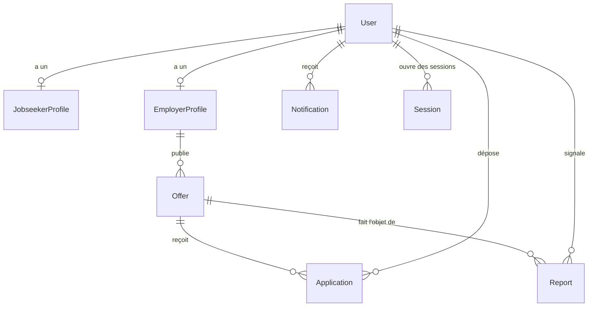

# GéoEmploi, Schéma de la base de données

Base : PostgreSQL **16** + extension **PostGIS** (données géo : latitude/longitude + requêtes `ST_DWithin`).

Pour découvrir l'ensemble des tables → généré depuis `prisma/schema.prisma` (source de vérité).

---

## 1. Schéma d'ensemble (relations)

Table récapitulative des tables (10) :

| Table | Rôle |
|---|---|
| `User` | Compte (authentification, rôle, consentement RGPD géoloc) |
| `JobseekerProfile` | Profil candidat (lié 1-1 à User) |
| `EmployerProfile` | Profil employeur (lié 1-1 à User) |
| `Offer` | Offre d'emploi géolocalisée |
| `Application` | Candidature à une offre |
| `Notification` | Notification utilisateur |
| `Report` | Signalement d'une offre |
| `Session` | Session de refresh token (rotation) |
| `_prisma_migrations` | Historique des migrations Prisma |
| `spatial_ref_sys` | Catalogue PostGIS des référentiels spatiaux |

---

## 2. Types (enums)

| Enum | Valeurs |
|---|---|
| `Role` | `JOBSEEKER` · `EMPLOYER` · `ADMIN` |
| `OfferStatus` | `ACTIVE` · `EXPIRED` · `ARCHIVED` · `REPORTED` |
| `ApplicationStatus` | `PENDING` · `VIEWED` · `INTERVIEW` · `ACCEPTED` · `REJECTED` · `WITHDRAWN` |
| `ReportStatus` | `PENDING` · `REVIEWED` · `DISMISSED` |

---

## 3. Tables détaillées

### 3.1 `User`
Compte utilisateur. Gère l'authentification JWT, le rôle et le consentement géolocalisation (RGPD).

| Colonne | Type | Nullable | Défaut | Notes |
|---|---|---|---|---|
| `id` | text (uuid) | non | `uuid()` | PK |
| `email` | text | non | - | **UNIQUE** |
| `passwordHash` | text | non | - | jamais renvoyé par l'API |
| `role` | `Role` | non | - | JOBSEEKER / EMPLOYER / ADMIN |
| `isSuspended` | boolean | non | `false` | 403 sur login/refresh si vrai |
| `geoConsent` | boolean | non | `false` | consentement géoloc RGPD |
| `geoConsentUpdatedAt` | timestamp | oui | - | date du dernier changement |
| `deletedAt` | timestamp | oui | - | suppression RGPD (soft) |
| `createdAt` | timestamp | non | `now()` | |
| `updatedAt` | timestamp | non | - | `@updatedAt` |

Index : `User_email_key` (unique) · `@index(role)` · `@index(isSuspended)` · `@index(deletedAt)`

Relations sortantes : `JobseekerProfile` (1-1), `EmployerProfile` (1-1), `Application[]`, `Notification[]`, `Report[]`, `Session[]`

### 3.2 `JobseekerProfile`
Profil candidat (chercheur d'emploi).

| Colonne | Type | Nullable | Défaut | Notes |
|---|---|---|---|---|
| `id` | text (uuid) | non | `uuid()` | PK |
| `userId` | text | non | - | **UNIQUE**, FK → `User.id` (cascade) |
| `firstName` | text | non | - | |
| `lastName` | text | non | - | |
| `phone` | text | oui | - | |
| `skills` | text[] | non | - | compétences (liste) |
| `experience` | text | oui | - | |
| `availability` | text | oui | - | |
| `latitude` | float | oui | - | candidat |
| `longitude` | float | oui | - | candidat |
| `cvPath` | text | oui | - | chemin disque local (stockage souverain), jamais exposé tel quel par l'API |
| `cvOriginalName` | text | oui | - | nom de fichier d'origine, affiché côté client |
| `cvUploadedAt` | timestamp | oui | - | |
| `createdAt` | timestamp | non | `now()` | |
| `updatedAt` | timestamp | non | - | `@updatedAt` |

### 3.3 `EmployerProfile`
Profil employeur / recruteur.

| Colonne | Type | Nullable | Défaut | Notes |
|---|---|---|---|---|
| `id` | text (uuid) | non | `uuid()` | PK |
| `userId` | text | non | - | **UNIQUE**, FK → `User.id` (cascade) |
| `companyName` | text | non | - | |
| `siret` | text | oui | - | |
| `verified` | boolean | non | `false` | vérification d'activité |
| `description` | text | oui | - | |
| `website` | text | oui | - | |
| `createdAt` | timestamp | non | `now()` | |
| `updatedAt` | timestamp | non | - | `@updatedAt` |

Relations sortantes : `Offer[]`

### 3.4 `Offer`
Offre d'emploi **géolocalisée**.

| Colonne | Type | Nullable | Défaut | Notes |
|---|---|---|---|---|
| `id` | text (uuid) | non | `uuid()` | PK |
| `employerId` | text | non | - | FK → `EmployerProfile.id` (cascade) |
| `title` | text | non | - | |
| `description` | text | non | - | |
| `latitude` | float | non | - | géolocalisation |
| `longitude` | float | non | - | géolocalisation |
| `address` | text | oui | - | |
| `commune` | text | oui | - | |
| `radiusKm` | float | non | `10` | périmètre de diffusion |
| `viewCount` | int | non | `0` | métrique dashboard employeur |
| `status` | `OfferStatus` | non | `ACTIVE` | |
| `sector` | text | oui | - | Restauration / Logistique / Santé / Commerce / Bâtiment / Tech / Services (contrainte Zod, pas d'enum Prisma : valeurs accentuées invalides comme identifiants) |
| `contractType` | text | oui | - | CDI / CDD / Intérim / Extra / Alternance / Stage |
| `salaryMin` | float | oui | - | |
| `salaryMax` | float | oui | - | |
| `salaryKind` | text | oui | - | brut / net |
| `workTime` | text | oui | - | |
| `experienceLevel` | text | oui | - | texte libre (Débutant accepté, 1-3 ans, 3-5 ans, 5 ans et plus) |
| `requiredSkills` | text[] | non | `[]` | compétences recherchées pour le poste |
| `geocodeSource` | text | oui | - | traçabilité géocodage (exigence Vignal) : toujours "api-adresse" |
| `geocodeScore` | float | oui | - | confiance renvoyée par la BAN (0..1) |
| `geocodeCitycode` | text | oui | - | code INSEE de la commune résolue |
| `geocodedAt` | timestamp | oui | - | date du géocodage |
| `geocodePrecision` | text | oui | `"commune"` | précision retenue pour latitude/longitude (exigence Florine Pontaillac, retour v1.0 du 08/09/2026) : toujours "commune" (centroïde officiel via geo.api.gouv.fr), jamais "adresse" |
| `geoPoint` | geography(Point,4326) | oui | - | synchronisé automatiquement depuis latitude/longitude par un trigger PostgreSQL (`offer_geopoint_sync`), jamais écrit par le code applicatif. Type Prisma `Unsupported`, absent du client Prisma classique |
| `publishedAt` | timestamp | non | `now()` | |
| `expiresAt` | timestamp | non | - | |
| `createdAt` | timestamp | non | `now()` | |
| `updatedAt` | timestamp | non | - | `@updatedAt` |

> Géolocalisation : lat/lng stockés en Prisma (source de vérité modifiable par l'appli) + colonne `geoPoint` dédiée pour les requêtes PostGIS (`ST_DWithin`/`ST_Distance` via `$queryRaw`), avec index GIST. Avant le 10 septembre 2026, ces requêtes recalculaient `ST_MakePoint(longitude, latitude)` à la volée dans la clause `WHERE`, un calcul non indexable qui forçait un `Seq Scan` complet de la table à chaque recherche (confirmé par `EXPLAIN ANALYZE`, `backend/loadtest/RAPPORT-2026-09-03.md`). Voir `backend/loadtest/RAPPORT-2026-09-10-index-geo.md` pour la mesure avant/après.

Index : `@index(status)` · `@index(expiresAt)` · `@index(employerId)` · GIST sur `geoPoint` (`Offer_geoPoint_idx`)

Relations sortantes : `Application[]`, `Report[]`

### 3.5 `Application`
Candidature d'un utilisateur à une offre.

| Colonne | Type | Nullable | Défaut | Notes |
|---|---|---|---|---|
| `id` | text (uuid) | non | `uuid()` | PK |
| `offerId` | text | non | - | FK → `Offer.id` (cascade) |
| `userId` | text | non | - | FK → `User.id` (cascade) |
| `status` | `ApplicationStatus` | non | `PENDING` | |
| `message` | text | oui | - | |
| `createdAt` | timestamp | non | `now()` | |
| `updatedAt` | timestamp | non | - | `@updatedAt` |

Contraintes : `@@unique([offerId, userId])` (1 candidature par offre et par user) · `@index(userId)` · `@index(offerId)`

### 3.6 `Notification`

| Colonne | Type | Nullable | Défaut | Notes |
|---|---|---|---|---|
| `id` | text (uuid) | non | `uuid()` | PK |
| `userId` | text | non | - | FK → `User.id` (cascade) |
| `title` | text | non | - | |
| `message` | text | non | - | |
| `read` | boolean | non | `false` | |
| `type` | text | non | - | `application_received` / `application_status` / `alert` |
| `createdAt` | timestamp | non | `now()` | |

Index : `@index([userId, read])`

### 3.7 `Report`
Signalement d'une offre par un utilisateur.

| Colonne | Type | Nullable | Défaut | Notes |
|---|---|---|---|---|
| `id` | text (uuid) | non | `uuid()` | PK |
| `offerId` | text | non | - | FK → `Offer.id` (cascade) |
| `userId` | text | non | - | FK → `User.id` (cascade) |
| `reason` | text | non | - | |
| `status` | `ReportStatus` | non | `PENDING` | |
| `createdAt` | timestamp | non | `now()` | |

Contrainte : `@@unique([offerId, userId])` (1 signalement par offre et par utilisateur)

### 3.8 `Session`
Gère les refresh tokens (rotation JWT).

| Colonne | Type | Nullable | Défaut | Notes |
|---|---|---|---|---|
| `id` | text (uuid) | non | `uuid()` | PK |
| `userId` | text | non | - | FK → `User.id` (cascade) |
| `refreshToken` | text | non | - | **UNIQUE** (hash sha256) |
| `expiresAt` | timestamp | non | - | |
| `createdAt` | timestamp | non | `now()` | |

---

## 4. Règles de suppression (cascade)

Tous les liens vers `User` (profils, applications, notifications, reports, sessions) sont en `ON DELETE CASCADE` : la suppression d'un compte (RGPD) entraîne la suppression de ses données liées.

| Table fille | FK → | Comportement |
|---|---|---|
| `JobseekerProfile` | `User.id` | Cascade |
| `EmployerProfile` | `User.id` | Cascade |
| `Application` | `User.id` / `Offer.id` | Cascade |
| `Notification` | `User.id` | Cascade |
| `Report` | `User.id` / `Offer.id` | Cascade |
| `Session` | `User.id` | Cascade |
| `Offer` | `EmployerProfile.id` | Cascade |

---

## 5. Notes RGPD & géospatiales

- **RGPD (suppression)** : `deletedAt` permet un soft-delete ; la suppression définitive est accidentée (cascade), voir module Auth.
- **Consentement géoloc** : `User.geoConsent` révocable à tout moment (sans supprimer compte/profil/candidatures), `PUT /api/users/me/geo-consent`.
- **Géo** : `latitude`/`longitude` (WGS84) sur `Offer` et `JobseekerProfile` ; requêtes de proximité via PostGIS `ST_DWithin` (psql `$queryRaw`).
- **Sécurité** : `passwordHash` n'est jamais exposé par l'API ; `refreshToken` stocké haché (sha256) en `Session`.

---

> Généré automatiquement depuis `prisma/schema.prisma` (référentiel des tables). Migration géo-consent : `20260901161125_add_geo_consent`. Migration CV : `20260903200232_add_jobseeker_cv_fields`. Migration champs métier Offer (secteur/contrat/salaire) : `20260904060852_add_offer_business_fields`. Migration expérience/compétences : `20260904061600_add_offer_experience_skills`. Migration traçabilité géocodage : `20260904144106_add_offer_geocode_traceability`. Migration précision commune : `20260908133321_add_offer_geocode_precision`. Migration statuts candidature (Vue/Entretien) : `20260909100443_add_application_viewed_interview`. Migration index géospatial GIST : `20260910095827_add_geo_point_gist_index`.
